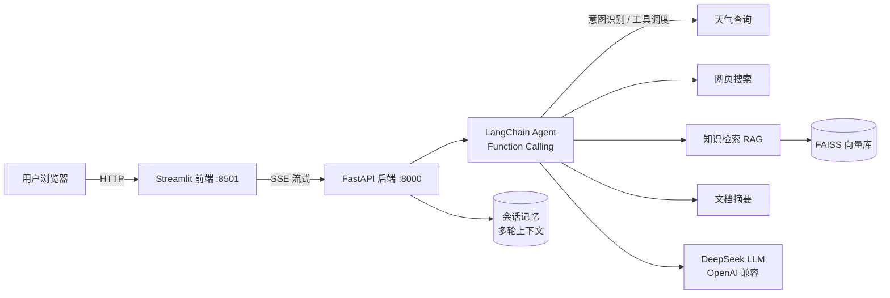

# 基于 LLM 的智能问答 Agent 系统

个人项目 · 基于 **LangChain + Function Calling + RAG** 的多轮对话智能问答系统。

## 功能特性

- **多轮对话 Agent**：基于 LangChain `create_tool_calling_agent`（Function Calling 机制）搭建，支持多轮上下文记忆（滑动窗口）
- **工具链调度**：Agent 根据用户意图自主选择并调度 4 个工具
  - `get_weather` —— 城市天气查询（Open-Meteo 免费接口，无需 Key）
  - `web_search` —— 网页搜索（DuckDuckGo，无需 Key）
  - `knowledge_search` —— 知识库语义检索（RAG）
  - `summarize_document` —— 文档摘要（长文档 Map-Reduce 分段总结）
- **RAG 知识库**：上传 PDF / TXT / MD / DOCX → 文档切分 → 向量化入库（FAISS）→ 语义检索；默认使用本地 bge 中文 embedding 模型（无需额外 API Key），也可配置远程 embedding 接口
- **流式输出**：FastAPI 以 SSE（Server-Sent Events）推送 token 与工具调用事件，前端逐字渲染并展示工具执行过程
- **对话历史管理**：多会话隔离、自动生成会话标题、历史查询与删除

## 架构



## 项目结构

```
llm-qa-agent/
├── backend/
│   ├── main.py               # FastAPI 服务：SSE 流式对话、会话/文档管理接口
│   ├── config.py             # 全局配置（.env）
│   ├── llm.py                # LLM 客户端工厂（OpenAI 兼容协议）
│   ├── agent/
│   │   ├── core.py           # Agent 构建与流式执行（astream_events）
│   │   ├── memory.py         # 会话记忆：多轮上下文、滑动窗口
│   │   └── tools/
│   │       ├── weather.py    # 天气查询工具
│   │       ├── search.py     # 网页搜索工具
│   │       └── knowledge.py  # RAG 检索 + 文档摘要工具
│   ├── rag/
│   │   └── knowledge.py      # FAISS 向量库管理（入库/检索/删除）
│   └── utils/
│       └── loader.py         # 文档加载与切分
├── frontend/
│   └── app.py                # Streamlit 交互界面
├── data/                     # 上传文档与向量索引（自动生成）
├── requirements.txt
└── .env.example
```

## 快速开始

```powershell
# 1. 创建虚拟环境并安装依赖
python -m venv .venv
.venv\Scripts\activate
pip install -r requirements.txt

# 2. 配置 API Key
copy .env.example .env
# 编辑 .env，填入 DeepSeek API Key（https://platform.deepseek.com 申请）

# 3. 启动后端（终端 1）
.venv\Scripts\python.exe -m uvicorn backend.main:app --host 0.0.0.0 --port 8000 --reload

# 4. 启动前端（终端 2）
.venv\Scripts\python.exe -m streamlit run frontend/app.py
```

Windows 下也可以直接双击 `start_backend.bat` 和 `start_frontend.bat`，然后访问 **http://localhost:8501**。

## API 一览（http://localhost:8000/docs 可查看交互式文档）

| 方法 | 路径 | 说明 |
|---|---|---|
| POST | `/api/chat` | 对话（SSE 流式返回 token / 工具调用 / 结果事件） |
| POST / GET | `/api/sessions` | 创建 / 列出会话 |
| GET | `/api/sessions/{id}/history` | 获取会话历史 |
| DELETE | `/api/sessions/{id}` | 删除会话 |
| POST / GET | `/api/documents` | 上传入库 / 列出知识库文档 |
| DELETE | `/api/documents/{name}` | 删除文档及其向量 |
| GET | `/api/health` | 健康检查 |

## 技术要点

1. **Agent 设计**：`create_tool_calling_agent` + `AgentExecutor`，系统提示词注入当前日期与知识库文档列表，LLM 通过 Function Calling 自主完成意图识别与工具编排；`handle_parsing_errors` 与 `max_iterations` 保证健壮性
2. **多轮上下文**：按 session 隔离的消息存储，`MessagesPlaceholder("chat_history")` 注入最近 N 轮对话
3. **RAG**：`RecursiveCharacterTextSplitter` 中文切分（chunk=400/overlap=60）→ bge 中文模型 / 远程 embedding → FAISS 持久化索引，检索结果带来源标注
4. **流式链路**：后端 `astream_events(version="v2")` 区分模型 token、工具开始/结束事件，SSE 推送；前端解析 SSE 流逐字渲染，工具调用过程实时可见
5. **可插拔模型**：任意 OpenAI 兼容服务（DeepSeek / Qwen / OpenAI / 中转站）仅需修改 `.env`
